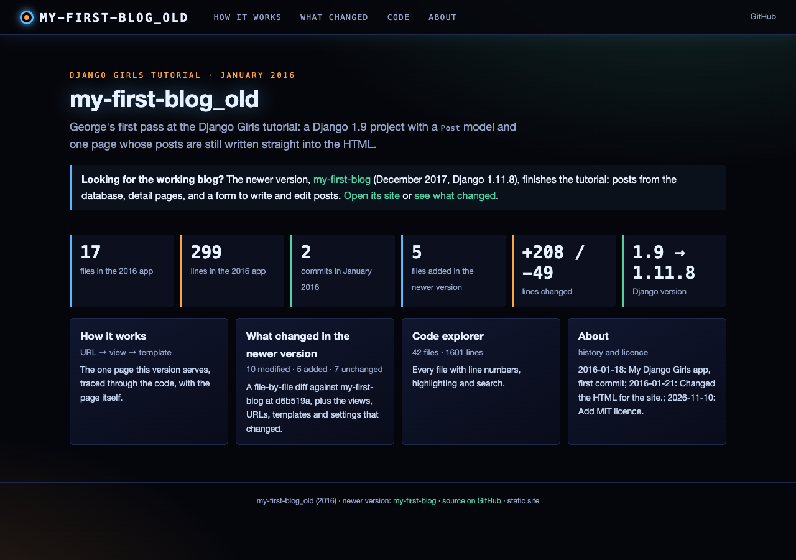
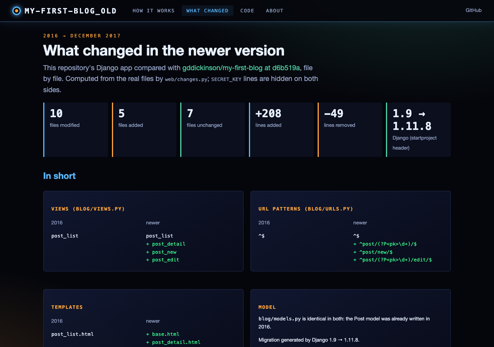
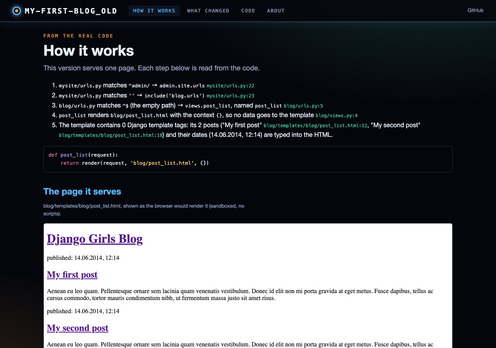
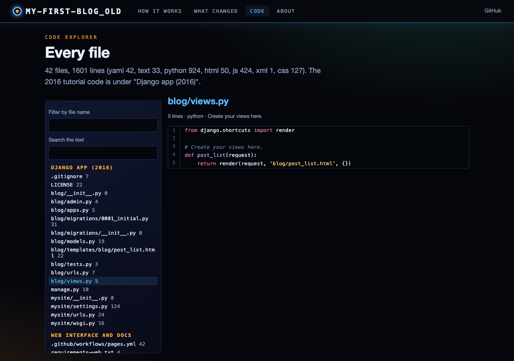

# my-first-blog_old

George's first pass at the [Django Girls tutorial](https://tutorial.djangogirls.org/), January 2016: a Django 1.9
project (`mysite`) with a `blog` app, a `Post` model and one page whose posts are still written into the HTML.

> **Newer version:** [gddickinson/my-first-blog](https://github.com/gddickinson/my-first-blog)
> ([site](https://gddickinson.github.io/my-first-blog/)) finishes the tutorial (December 2017): posts from the
> database, detail pages, and a form to write and edit posts.

**Web site:** https://gddickinson.github.io/my-first-blog_old/

## Web interface

```bash
pip install -r requirements-web.txt
python run_web.py        # http://127.0.0.1:8257
```

A showcase built from the files (the 2016 code targets Django 1.9, which does not run on current Python, so the site
does not run it):
- **How it works**: URL pattern -> view -> template, traced in the code with file:line links, and the page it serves.
- **What changed**: a file-by-file diff (difflib) against my-first-blog at commit `2aaf725`, plus the views, URL
  patterns, templates and settings that changed (ast). The newer repo's files are stored in
  `web/data/newer_snapshot.json` by `python scripts/make_newer_snapshot.py --repo ../my-first-blog`.
- **Code**: every file with line numbers, highlighting and search (secret-looking strings redacted).
- **About**: history, how to run the 2016 code, licence.

The static site (`python scripts/build_static.py`) is published by `.github/workflows/pages.yml` on push to `master`.
Tests: `python -m pytest -q tests`.

| Home | What changed |
|---|---|
|  |  |
| **How it works** | **Code** |
|  |  |

`SECRET_KEY` is read from the `DJANGO_SECRET_KEY` environment variable (it used to be committed in
`mysite/settings.py`).

## Licence

MIT, see [LICENSE](LICENSE).
